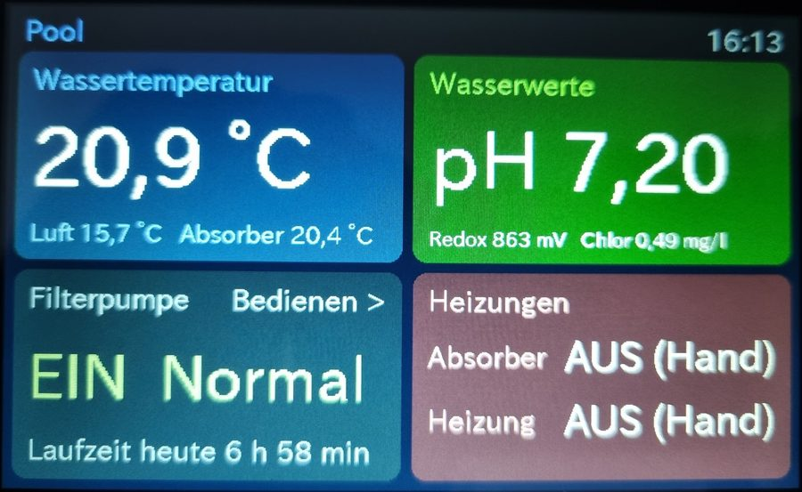
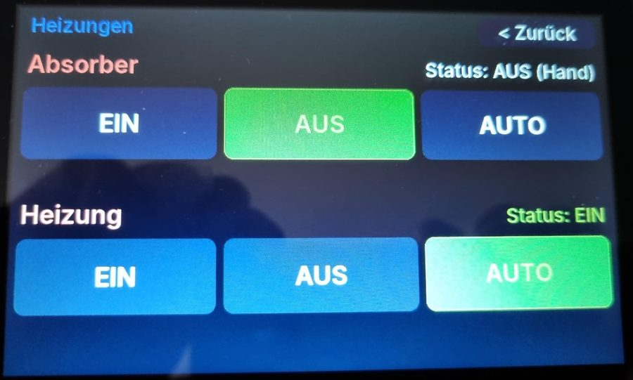
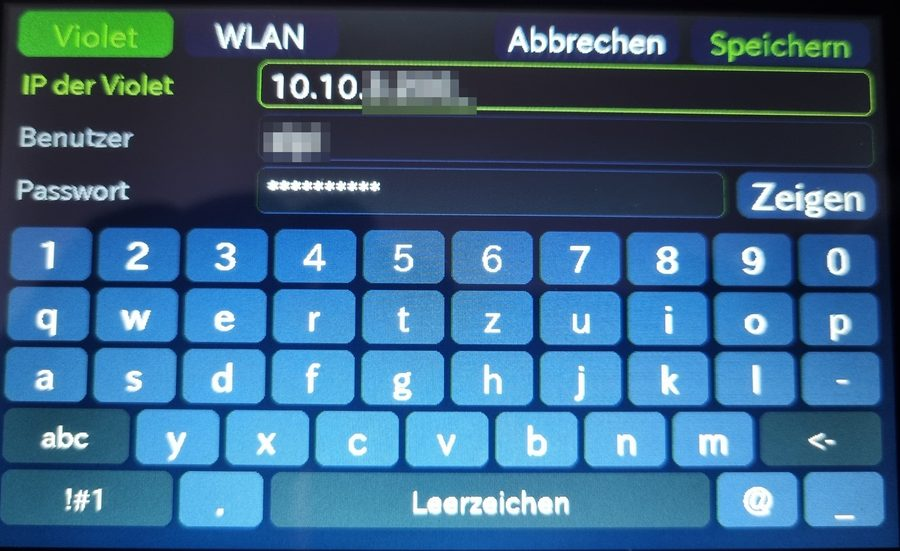
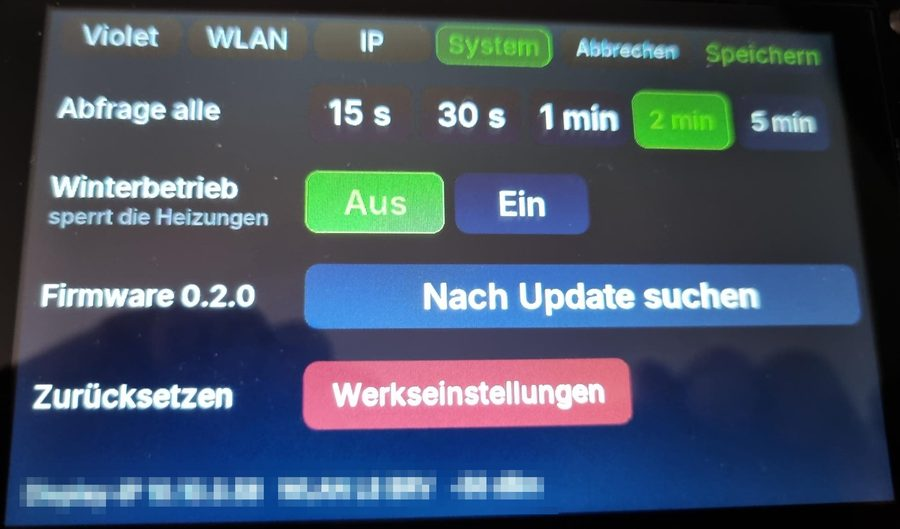

# Violet Pool-Display

Eigenständiges Touch-Display für die **Violet-Poolsteuerung** von PoolDigital –
auf einem günstigen ESP32-S3-Display, ohne ioBroker, Home Assistant oder Server.
Das Display holt sich die Werte per WLAN direkt von der Violet.

🇬🇧 [English summary below](#english)

> **Kein offizielles Produkt von PoolDigital.** Bei Fragen zum Display bitte hier
> im Repository ein Issue anlegen, nicht bei PoolDigital. Nutzung auf eigene Gefahr –
> das Display kann die Filterpumpe und die Rückspülung schalten.

## Bilder

| Übersicht | Heizungen bedienen |
|---|---|
|  |  |

| Einrichtung am Display | System |
|---|---|
|  |  |

## Funktionen

- **Übersicht mit vier großen Kacheln:** Wassertemperatur, Wasserwerte (Kachel
  grün/gelb/rot), Filterpumpe, Heizungen
- **Antippen schaltet durch:** Wasser- / Luft- / Absorbertemperatur und pH / Redox / Chlor
- **Filterpumpe:** EIN / AUS / AUTO, Drehzahl ECO / Normal / Boost, Rückspülung starten
- **Heizungen:** Absorber und Heizung EIN / AUS / AUTO – EIN und AUTO mit Sicherheitsabfrage
- **Winterbetrieb:** sperrt die Bedienung der Heizungen, z. B. wenn die Anlage
  entleert ist und Kugelhähne geschlossen sind
- **Einrichtung komplett am Display:** WLAN suchen, feste IP oder DHCP, IP der Violet,
  Benutzer und Passwort mit *Login testen* – Bildschirmtastatur mit Umlauten
- **Abfrageintervall** wählbar (15 s bis 5 min)
- **Updates über WLAN:** prüft einmal am Tag auf eine neue Version, Installation per Tipp
- **Werkseinstellungen** direkt am Display
- **Ruhiges Bild:** Ausgabe ans Panel über einen Zwischenpuffer im internen RAM –
  kein Zucken beim Datenabruf, beim Speichern oder während eines Updates
- Dimmt nach 5 Minuten ohne Berührung; die erste Berührung weckt nur auf

## Hardware

| | |
|---|---|
| Display | **Elecrow CrowPanel ESP32 5.0"**, SKU **DIS07050H**, Board-Revision **V3.0** |
| Chip | ESP32-S3-WROOM-1-N4R8 (4 MB Flash, 8 MB PSRAM) |
| Auflösung | 800 × 480, kapazitiver Touch |

**Bezugsquelle:** [CrowPanel 5.0" bei Amazon](https://www.amazon.de/dp/B0DL5WB7RQ) ·
[Elecrow-Wiki zum 5.0"](https://www.elecrow.com/wiki/esp32-display-502727-intelligent-touch-screen-wi-fi26ble-800480-hmi-display.html)

Beim Kauf auf **Board-Revision V3.0** achten – sie steht auf der Rückseite der
Platine neben dem Flachbandkabel.

**Geplant:** Unterstützung für das [CrowPanel 7.0"](https://www.amazon.de/dp/B0CHDYR54Q) (DIS08070H) –
noch nicht lauffähig, bitte vorerst das 5"-Modell verwenden.

Getestet ist nur diese Variante. Andere CrowPanel-Größen oder ältere Revisionen
haben eine andere Pin-Belegung.

## Installation

### Einfach: im Browser flashen

1. Display per USB-C anschließen.
2. **[Web-Installer öffnen](https://alpi-brv.github.io/violet-display/)** in Chrome oder Edge.
3. *Installieren* klicken, Anschluss wählen – fertig.

### Selbst bauen (PlatformIO)

1. Repository klonen und den Ordner in VS Code mit der PlatformIO-Erweiterung öffnen.
2. Unten in der Statusleiste auf *Upload* (Pfeil) klicken.

Grundlage ist Arduino-ESP32 3.x über [pioarduino](https://github.com/pioarduino/platform-espressif32).
Der **erste Build dauert lange** (rund 20–30 Minuten, mehrere GB Download), weil die
Arduino-Bibliotheken mit eigenen Einstellungen neu gebaut werden – danach geht es schnell.

Für eigene Startwerte beim Entwickeln eine Datei `src/config_local.h` anlegen –
sie wird von Git ignoriert:

```cpp
#define WIFI_SSID   "MeinWLAN"
#define WIFI_PASS   "geheim"
#define VIOLET_HOST "192.168.1.50"
#define VIOLET_USER "admin"
#define VIOLET_PASS "geheim"
```

## Einrichtung

Beim ersten Start öffnet das Display die Einstellungen von selbst:

1. Reiter **WLAN**: *Suchen*, Netz antippen, WLAN-Passwort eingeben.
2. Reiter **Violet**: IP-Adresse der Violet, Benutzer und Passwort.
3. **Speichern** – das Display verbindet sich und meldet, ob die Violet erreichbar ist.

Später öffnet das **Zahnrad** neben „Pool“ die Einstellungen
(oder die Kopfzeile 2 Sekunden gedrückt halten).

| Reiter | Inhalt |
|---|---|
| Violet | IP der Violet, Benutzer, Passwort, *Login testen* |
| WLAN | Netz suchen und wählen, WLAN-Passwort |
| IP | Automatisch (DHCP) oder feste IP mit Subnetz, Gateway, DNS |
| System | Abfrageintervall, Winterbetrieb, Update, Werkseinstellungen |

Benutzer und Passwort sind nur für Schaltbefehle nötig; das Lesen der Werte
funktioniert bei der Violet ohne Anmeldung. Änderungen an WLAN oder IP starten
das Display neu.

## Updates

Das Display fragt einmal am Tag hier nach der neuesten Version. Gibt es eine,
erscheint oben „Update … verfügbar“. Installiert wird über **Einstellungen →
System → Update installieren** – das Display lädt die neue Firmware per WLAN,
startet neu und behält alle Einstellungen.

> **Umstieg von 0.1.x / 0.2.x auf 0.3.0:** Ab 0.3.0 läuft das Display auf einer neuen
> Grundlage (ESP-IDF 5). Dieser Wechsel geht einmalig nur per USB über den
> [Web-Installer](https://alpi-brv.github.io/violet-display/) – beim Löschen-Hinweis
> „Nein“ wählen, dann bleiben alle Einstellungen erhalten. Danach kommen Updates wieder über WLAN.

## Bedienung

- Kacheln **Wassertemperatur** und **Wasserwerte** antippen → nächster Messwert
- Kacheln **Filterpumpe** und **Heizungen** antippen → Bedienseite
- Pumpe **AUS**, **Rückspülung**, Heizung **EIN** und **AUTO** fragen vorher nach
- Drehzahl antippen, während die Pumpe in AUTO läuft → Rückfrage, dann manuell in dieser Stufe
- Manuell EIN/AUS gilt, bis **AUTO** gedrückt wird
- Bedienseiten schließen sich nach 60 Sekunden ohne Berührung

## Sicherheit

Die Zugangsdaten werden unverschlüsselt im Flash des ESP32 gespeichert. Wer das
Display per USB an einen Rechner anschließt, kann sie auslesen. Für ein Display
im Technikraum ist das in der Regel unkritisch.

## Verwandtes Projekt

[ioBroker.violet](https://github.com/AlPi-BRV/ioBroker.violet) – Adapter für die
Violet-Poolsteuerung in ioBroker.

## Lizenz

MIT – siehe [LICENSE](LICENSE).
Verwendete Bibliotheken: [LovyanGFX](https://github.com/lovyan03/LovyanGFX),
[ArduinoJson](https://github.com/bblanchon/ArduinoJson).

---

## English

Standalone touch display for the **Violet pool controller** by PoolDigital, running
on an Elecrow CrowPanel ESP32-S3 5" (DIS07050H, V3.0). Reads values directly from the
Violet over Wi-Fi – no ioBroker or server required.

- Overview: water temperature, water values (pH, ORP, chlorine), filter pump, heaters
- Control: filter pump ON / OFF / AUTO with speed, manual backwash, solar and heater
  ON / OFF / AUTO (with confirmation), winter mode locks the heaters
- Setup entirely on the device: Wi-Fi scan, static IP or DHCP, Violet IP, user and
  password with login test, polling interval, factory reset (gear icon)
- Over-the-air updates from GitHub releases
- Flash in the browser: **[web installer](https://alpi-brv.github.io/violet-display/)**

The user interface is German. Not an official PoolDigital product; use at your own risk.
